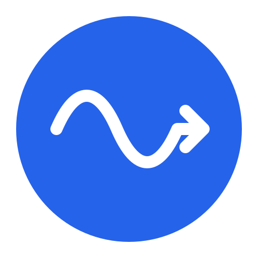

<p align="center">
  
</p>

<h1 align="center">声渡 / WaveFerry</h1>

声渡（WaveFerry）是一款面向 Android 12 及以上设备的局域网音频投送应用。它读取用户授权应用正在播放的音频，并通过 AirPlay 1 / RAOP 发送到同一局域网内的电视、盒子或音响。

## 功能

- 通过 DNS-SD 自动发现 `_raop._tcp` 和 `_airplay._tcp` 接收器。
- 捕获 Android Playback Capture 允许的 44.1 kHz、双声道、PCM 16-bit 音频。
- 支持 RAOP TCP 与 UDP 传输，以及 `et=0` 和 `et=1` 会话。
- 同步歌曲信息、封面和播放进度到兼容接收器。
- 接收器支持 DACP 时，可以从接收器反向控制手机播放、暂停、上一首和下一首。
- 可选在投送时静音本机媒体音量，并在会话结束后恢复。

## 兼容条件

| 项目 | 要求 |
| --- | --- |
| Android | Android 12（API 31）或更高版本 |
| 网络 | 手机与接收器处于同一 Wi-Fi / 局域网 |
| 音频源 | 源应用允许 Android Playback Capture |
| 接收器 | 支持 44.1 kHz / 16-bit / 双声道旧式 RAOP |
| 反向控制 | 接收器实现 DACP，且手机已授予通知使用权 |

Android 14 及以上会在每次投送前显示系统级捕获对话框，让用户选择一个应用。声渡只创建音频录制器，不采集或传输屏幕画面。

## 使用方法

1. 安装并打开声渡，确保手机与接收器位于同一局域网。
2. 从设备列表选择电视、盒子或音响；没有找到时点击“扫描”。
3. 点击“开始”，授予录音权限，并在系统捕获对话框中选择要投送音频的应用。
4. 在所选应用中开始播放。连接状态可从声渡的常驻通知或主界面查看。
5. 点击“停止”或使用常驻通知结束会话。

通知使用权不是基础投送的必需条件，但当前歌曲展示、暂停同步和接收器反向控制依赖它。

## 当前不支持

- 仅支持 AirPlay 2 / FairPlay 的设备。
- HomePod、新式配对、PIN、密码或 Digest 认证。
- 视频或屏幕镜像、多房间同步、接收端音量控制。
- DLNA/UPnP、Chromecast 或 Google Cast 的发现与推流。
- 不允许 Playback Capture 的音频源应用。

## 构建

需要：

- JDK 17
- Android SDK Platform 36
- Gradle Wrapper

构建调试包：

```bash
./gradlew :app:assembleDebug
```

完整本地验证：

```bash
./gradlew :app:testDebugUnitTest :app:lintDebug :app:assembleDebug
```

首次运行可能需要联网下载 Gradle、Android 和 JUnit 依赖；如果本地没有缓存，离线环境会先失败。

调试 APK 位于：

```text
app/build/outputs/apk/debug/app-debug.apk
```

## 隐私

声渡不包含账号、广告、分析 SDK、云端服务或遥测功能。音频、歌曲信息和封面只在设备内存中处理，并按用户操作发送到所选局域网接收器。投送期间用于接收器播放控制的临时局域网服务只接受当前所选接收器的命令。完整说明见 [PRIVACY.md](PRIVACY.md)。

## 第三方声明

RAOP 实现参考了 PulseAudio 的 RAOP 客户端。相关声明与 LGPL-2.1-or-later 文本见 [THIRD_PARTY_NOTICES.md](THIRD_PARTY_NOTICES.md) 和 [LICENSES/LGPL-2.1-or-later.txt](LICENSES/LGPL-2.1-or-later.txt)。
